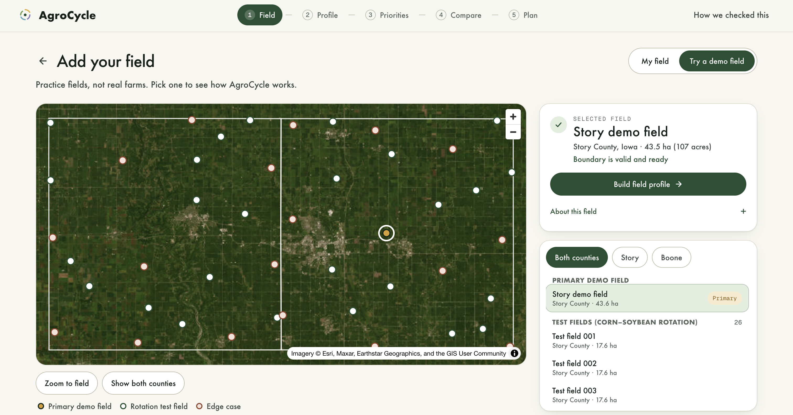
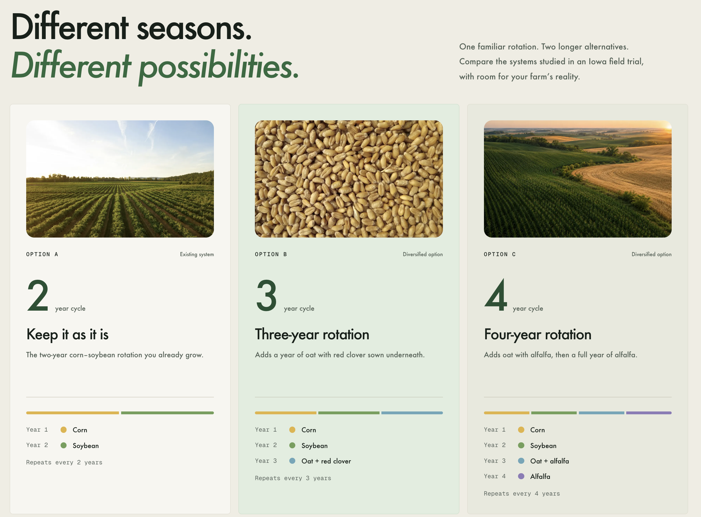
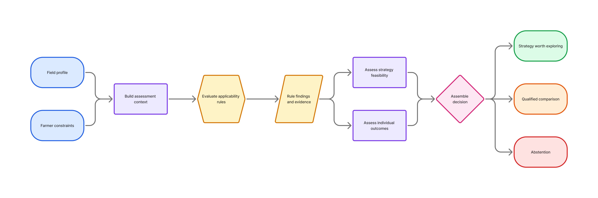
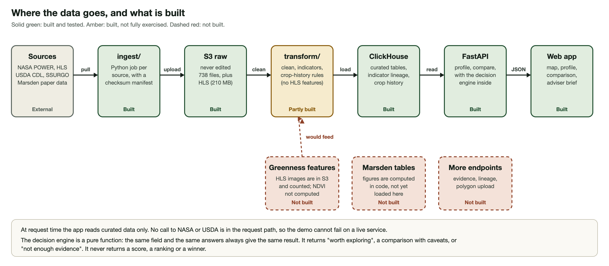

# AgroCycle

**A crop-rotation decision-support tool that tells farmers what the evidence can and cannot say about their field, and says "not enough evidence" when that is the honest answer.**

Built for the **NASA Space Apps Challenge 2026** challenge _"Field Shift: Adapting Farms with NASA Data"_.

[](https://github.com/Nancy9ice/AgroCycle/actions/workflows/deploy.yml)
[**Live demo**](https://agrocycle.praxicraft.com) · [API reference](https://agrocycle.praxicraft.com/redoc) · [Screenshots](docs/demo/README.md) · [Product requirements](PRD.md)



> **Status:** a working hackathon build, not a finished product. All fields are **demonstration polygons**, not real farms. No rule has been reviewed by an agronomist. See [Validation, limitations and responsible use](#validation-limitations-and-responsible-use).

## Contents

- [The problem](#the-problem)
- [Our solution](#our-solution)
- [How it works](#how-it-works)
- [Data and scientific foundation](#data-and-scientific-foundation)
- [Decision approach](#decision-approach)
- [System architecture](#system-architecture)
- [Validation, limitations and responsible use](#validation-limitations-and-responsible-use)
- [Explore the repository](#explore-the-repository)
- [Team, acknowledgements, references and license](#team-acknowledgements-references-and-license)

---

## The problem

Most Iowa farmland grows maize and soybean in a two-year rotation. Longer rotations that add a small grain and a forage legume have a long agronomic history, and experiments suggest they can cut applied nitrogen and herbicide while holding yields. Whether a farmer should consider one is not a simple question, because the answer depends on things that rarely sit in one place:

- **The field.** Its crop history, soil, drainage and the weather it actually gets, which is changing.
- **The farm.** Whether there is manure, someone to buy oats or alfalfa, and a combine or contractor that can harvest small grain. These are constraints, not footnotes.
- **The evidence.** Most of what is known comes from a handful of research farms. A result from one site over nine seasons is not a forecast for a particular field.

Farmers and advisers are left to stitch this together by hand, and tools that do stitch it together usually hide the doubt behind a single score or a confident recommendation. The gap AgroCycle addresses is not a lack of data. It is a lack of a way to connect environmental data, experimental evidence and farm constraints **while showing exactly how far each claim can be trusted**.

## Our solution



AgroCycle lets a farmer or an agricultural adviser pick a field, see what is known about it and where each number came from, say what is and is not possible on their farm, and compare three rotations side by side. It returns one of three answers: a strategy **worth exploring**, a **qualified comparison**, or an **abstention**. Every output states its evidence type, its scale and what it cannot tell you.

**Who it is for:** farmers exploring rotation options, and the agricultural advisers and extension professionals who work with them.

**What makes the approach different**

- **It can say no.** When the evidence is missing, inadequate or outside the supported domain, it abstains, and it says why.
- **Unknown is never treated as neutral.** A question the farmer has not answered withholds or qualifies the result. It is never read as a yes.
- **No score, no winner.** There is no composite number and no ranking. The three strategies are always shown, side by side.
- **Rules, not a black box.** The decision is a deterministic, versioned rule table that a reader who does not write code can review. AI may explain a stored result, but it never produces one.
- **Evidence is labelled and sorted.** Observed data, derived indicators, survey data, experimental records, published findings and assumptions are kept apart.

**What it does not claim to do.** It does not predict yield or profit for a field. It does not claim soil-carbon, erosion or nitrate-leaching benefits: those outcomes are present in the engine and permanently closed as _not assessed_. It does not tell a farmer what to plant.

## How it works

The web app takes a user through a short journey.

1. **Select a demonstration field.** A map and list of 45 practice fields in Story and Boone counties, Iowa. Boundary checks run in the browser.
2. **Explore its profile.** Crop history, soil and weather for the field, each with its source, its scale (field, grid or region) and a note on what it cannot establish.
3. **State priorities and constraints.** Twelve optional questions. Four feed the engine (manure, a use or buyer for forage, a use or buyer for oats, small-grain harvest equipment). "Don't know" is a valid answer and is treated as unknown.
4. **Compare the strategies.** (A) the existing two-year maize–soybean rotation, (B) three-year maize–soybean–oat/red clover, (C) four-year maize–soybean–oat/alfalfa–alfalfa. One outcome banner, three options, never ranked.
5. **Review evidence, trade-offs and uncertainties.** One card per outcome, with the Marsden Farm figures where the engine may state them, an evidence-type badge, what the figure does not tell you, and whether it applies to this farm. Outcomes that cannot be assessed are shown, not hidden.
6. **Generate an adviser brief.** A printable page with the result, the options, the answers, questions to take to a local adviser, and the sources.

Screenshots of every screen, with the exact answers used for each, are in [`docs/demo/`](docs/demo/README.md). They were captured on 2026-11-15, before the landing page was redesigned, so the home page will look different today.

## Data and scientific foundation

AgroCycle uses several data sources, and keeps them apart on every screen because they support different kinds of claim.

| Source | What it provides | Role today |
|---|---|---|
| **NASA POWER** | Daily temperature, precipitation and radiation on a roughly 50 km grid, for the 45 fields over 11 seasons and for the Marsden site | Eight climate indicators in the field profile (growing degree days, frost window, dry spells, precipitation and others). A required input to the engine: if one cannot be computed, the engine withholds its answer. **No rule currently compares a field's climate with Marsden's.** |
| **NASA HLS** (Harmonized Landsat Sentinel-2) | 30 m surface reflectance, 2023–2025 | Ingested and processed: valid-pixel counts, NDVI and bare-field windows are loaded. They feed the **cover calendar** on the comparison page (what the images say about cover on the field, month by month, 2023–2025, observed only; it never says which crop grew). **Not used by any rule**, and the profile's vegetation section still reports "not loaded". |
| **USDA Cropland Data Layer** | Annual crop classification, 2015–2025 | Crop history. This is what decides whether a field is in the domain the evidence covers: a field not in a maize–soybean rotation abstains. |
| **USDA NRCS SSURGO** | Soil survey map units and properties | Organic matter (0–30 cm), drainage class and water storage, area-weighted to the field. A survey map, not a sample of the field. |
| **USDA NAIP** | Aerial photographs | A reference photo of each field. Not used as crop ground truth. |
| **USDA NASS QuickStats** | County statistics | Loaded as county context. Not used by any rule. |

### Experimental research

| Source | What it provides | Role today |
|---|---|---|
| **Marsden Farm experiment**, Davis et al. (2012) and its supplementary records | Nine seasons of two-, three- and four-year rotations at one Iowa research farm | The evidence the whole comparison rests on. AgroCycle reproduced the management comparisons from the supplementary records: applied nitrogen of 74.5, 56.6 and 40.8 kg N/ha/yr and herbicide active ingredient of 1.925, 0.261 and 0.195 kg/ha/yr for the two-, three- and four-year systems. Yield, profit and weed findings are attributed to the paper and not recomputed. |

The Marsden figures are the researchers' results at one site. They are the anchor for the comparison, not a prediction for any field here. One reproduced figure does not match the paper (two-year manufactured nitrogen is 74.5 from the supplement against 80 in the text) and is reported, not corrected.

## Decision approach

The engine takes a **field profile** and the **farmer's constraints** and returns one decision. It is deterministic: the same inputs always give the same result, and nothing in it is learned or random.



**How information enters.** The profile and the farmer's answers are flattened into one context. Anything not established is `UNKNOWN`, which is a distinct value and never `False`.

**How rules decide applicability.** A table of 14 rules, each with one condition and one target, asks whether the Marsden evidence transfers to this field and farm. Rules apply per outcome, never per strategy. No manure access limits the nitrogen comparison and leaves the herbicide comparison untouched. Each rule records its rationale and its review status.

**The three outcomes.**

| Outcome | Meaning | Triggered when |
|---|---|---|
| **Strategy worth exploring** | A reasonable candidate for local evaluation. Not a recommendation. | At least one diversified option is operationally available and every claimable outcome is in domain. |
| **Qualified comparison** | The strategies can be compared but not separated. | Some outcomes are qualified or withheld, but at least one can still be spoken to. |
| **Abstention** | The evidence is missing, inadequate or out of domain. | The field is not in a maize–soybean rotation, or no outcome survives the rules. |

**Why there is no score and no winner.** A single number would hide the weights and assumptions behind it, and the evidence does not support ranking one rotation above another for a particular field. The engine returns all three strategies, each outcome with its own status, and the open questions. The farmer's priorities are recorded in the result but never change it. The engine can also reorder the outcomes and name the evidence gaps that matter for the priorities chosen, so that what is shown first follows what the farmer said matters. That reordering is built and tested but not yet switched on in the app, and it never changes the decision, the strategies' feasibility or any outcome's status.

Implementation details, input and output contracts, the rule table and how to change it safely are in the [**engine README**](engine/README.md). The rules are also published as a [generated catalogue](docs/rules/strategy-profiles-and-applicability.md) that a non-programmer can review.

## System architecture



_The diagram marks what is built_


| Component | What it does | Documentation |
|---|---|---|
| **Data pipeline** (`ingest/`, `transform/`) | Pulls each source into S3 unchanged, then cleans it and computes indicators, crop history and the Marsden reproduction into ClickHouse, with a lineage row for every indicator. | [`specs/tech-stack.md`](specs/tech-stack.md) |
| **Decision engine** (`engine/`) | Pure Python. Takes a profile and constraints, returns a decision. Holds the rule table. | [`engine/README.md`](engine/README.md) |
| **API** (`api/`) | FastAPI service. Builds each field's profile from stored indicators, runs the engine in-process, stores each result, and answers questions about stored results. | [`api/README.md`](api/README.md) |
| **Web app** (`web/`) | Next.js. The five-step journey. Calls the API from the server; the browser never calls it directly. | [`web/README.md`](web/README.md) |

The API is the **one authoritative decision engine**. The web app carries a TypeScript copy only as a labelled offline fallback for development, and a test fails if that copy drifts from the Python engine.

## Validation, limitations and responsible use

AgroCycle is built to be checked. Everything below says what has been verified, where its evidence applies, and what comes next.

### What has been built and verified

- **The full journey works end to end**, on live indicators for all 45 fields.
- **The engine is tested for the behaviour that matters most.** Its 137 tests cover the four categories the roadmap requires (in domain, out of domain, missing data, abstention), that an unanswered question is never read as a yes, and that closed outcomes can never be claimed.
- **The Marsden reproduction matches its target figures.** One reproduced value differs from the paper's text and is documented rather than corrected.
- **The engine behaves as designed across the whole test set.** A sweep runs it over all 45 fields under three constraint scenarios (rules version `2026-11-15.5`). With every constraint stated, **26 fields are worth exploring and 19 abstain**. The 19 are the 18 fields outside a maize–soybean rotation plus one rotation field whose soil data is incomplete. Withhold manure, or answer nothing, and those 26 become qualified comparisons. The result moves with the evidence.
- **Rules that do not fire are reported, not hidden.** Six of the 14 rules never fire on this test set. They are guardrails for situations the demonstration fields do not contain, and the sweep lists them.

### Where the evidence applies

- **Pilot geography:** Story and Boone counties, Iowa. This is a bounded pilot, not a universal crop-selection system.
- **Demonstration polygons:** all 45 fields were drawn by the team and are not real farm boundaries. Results are counts across a small test set, indicative rather than statistically strong. Agreement between the team's field labels and the engine is not independent validation, because both derive from the same Cropland Data Layer.
- **One experimental anchor:** the comparison rests on the Marsden Farm experiment, one research site over nine seasons. That is why the result is framed as a candidate for local evaluation and never as a forecast for a field.
- **Input scale:** climate is grid data about 50 km across and soil is a survey map. Each value is labelled with its scale so it is never mistaken for a field measurement.
- **Agronomic explanation is added only when it is sourced.** Seven of eight crop claims (for example, nitrogen fixation or soil structure) are waiting for a citable source, so they stay off the screen rather than being asserted without one.
- **Climate transferability is deliberately not assessed yet.** The one rule that compared a field's climate with Marsden's was withdrawn because it could never fire on this test set, and a guardrail that cannot trigger would only give false assurance.

### What comes next

- **Expert review of the rules.** Every rule is a conservative, team-proposed guardrail with its rationale written down, ready for an Iowa-knowledgeable adviser to confirm or change. The generated [rule catalogue](docs/rules/strategy-profiles-and-applicability.md) is written so a reviewer who does not read code can do this.
- **Sign-off of the validation matrix.** Its ten scenarios and their expected outcomes are with two teammates for review.
- **Farmer and adviser feedback.** No farmer or adviser has used the app yet.

### Responsible use

AgroCycle **supports decisions; it does not replace agronomic advice.** The strongest thing it ever says is that a strategy is a candidate for local evaluation, and the result says in words that this is not a recommendation. The farmers still decide what strategy they would like to use.

## Explore the repository

| Where | What is there |
|---|---|
| [`engine/README.md`](engine/README.md) | The decision engine: contracts, rules, validation, how to change a rule |
| [`api/README.md`](api/README.md) | The FastAPI service: endpoints, configuration, deployment |
| [`web/README.md`](web/README.md) | The Next.js app: journey, API integration, configuration |
| [`PRD.md`](PRD.md) | Requirements, evidence rules, validation plan and the numbered source register |
| [`specs/`](specs/) | [Mission](specs/mission.md), [tech stack](specs/tech-stack.md), [roadmap and progress tracker](specs/roadmap.md), [development rules](specs/development-rules.md), and one spec folder per feature in `specs/features/` |
| [`docs/`](docs/) | [Method](docs/method/ds2-scientific-method.md), [rule catalogue](docs/rules/strategy-profiles-and-applicability.md), [validation write-ups](docs/validation/), [diagrams](docs/diagrams/README.md), [screenshots](docs/demo/README.md), source requirement sheets |

```
common/     shared settings and the S3 and ClickHouse clients
ingest/     extraction jobs, one per source
transform/  cleaning, indicators, schema checks, ClickHouse loads
engine/     deterministic decision engine and rule table
api/        FastAPI service
web/        Next.js frontend
scripts/    smoke tests and one-off helpers
tests/      pytest tests for the pipeline
data/       demo field polygons and county boundaries (tracked); raw and output data are not
```

### Run it locally

Needs Python 3.11+ and [`uv`](https://docs.astral.sh/uv/); Node.js for the web app.

1. `make setup` installs the Python dependencies.
2. Copy `.env.example` to `.env` and fill in the AWS and ClickHouse values (ClickHouse uses the HTTP port, usually 8123, or 8443 with `CLICKHOUSE_SECURE=true`). The database is `agrocycle`. Credentials are never committed.
3. `make check` runs lint and the tests. It needs no credentials.
4. Start the API and the web app:

```bash
make api                                          # http://localhost:8000 , docs at /docs
cd web && cp .env.example .env.local              # then set AGROCYCLE_API_URL=http://localhost:8000
npm run dev                                       # http://localhost:3004
```

Without `AGROCYCLE_API_URL` the web app answers from its labelled offline copy of the engine. That is for development only: it sees no weather and no drainage, so never use it for a real field. In production the copy is off, and a deployment with no API shows an error instead of quietly answering from it.

After any change to `engine/`, run `cd web && npm run sync:engine` and commit the result. `api/tests/test_web_export_is_current.py` fails until you do.

Smoke tests (`uv run python -m scripts.smoke_s3`, `scripts.smoke_clickhouse`) check the connections once credentials are in place. Raw-data extraction is for the data engineer and needs AWS and Earthdata credentials: `uv run python -m ingest.run <source>` is a dry run and `--execute` uploads to S3, which cannot be undone. Environment variables are listed in the [API README](api/README.md#5-configuration) and the [web README](web/README.md#5-configuration). `data/sample/` is a small tracked sample of every source for one field, so development and tests need no S3 access.

**Contributing.** Read [`specs/development-rules.md`](specs/development-rules.md) first: it sets out roles, feature specs, status updates and the git workflow. To change a rule, follow the procedure in [section 14 of the engine README](engine/README.md#14-adding-or-modifying-rules).

## Team, acknowledgements, references and license

### Team

| Role | Contribution |
|---|---|
| Data engineer (**Nancy Amandi**) | Extraction of every source, the S3 raw store, ClickHouse loads and lineage |
| Data scientist 1 (**Hannah Igboke**) | HLS and CDL requirements, crop sequences, NDVI and bare-field windows, field validation |
| Data scientist 2 (**Joseph Edet**)| POWER, SSURGO and Marsden requirements, climate and soil indicators, the Marsden reproduction, strategy profiles, applicability rules and the decision engine |
| Backend engineer (**Chidera Ozigbo**)| The API, provenance and the validation endpoint |
| Frontend engineer (**Awwal Anileleye**)| The map, profile, comparison and adviser-brief interface. That is, the website. |

Detailed roles are in [`specs/mission.md`](specs/mission.md).

### Acknowledgements

AgroCycle stands on public data and published research: NASA's POWER and HLS teams, the USDA National Agricultural Statistics Service, Natural Resources Conservation Service and National Agriculture Imagery Program, and the researchers behind the Marsden Farm experiment at Iowa State University, whose openly published records make the comparison possible.

### References

The full numbered source register is in [`PRD.md`](PRD.md), section 17. The sources this README relies on:

- Davis, A.S., Hill, J.D., Chase, C.A., Johanns, A.M. and Liebman, M. (2012). Increasing cropping system diversity balances productivity, profitability and environmental health. _PLOS ONE_ 7(10): e47149. <https://doi.org/10.1371/journal.pone.0047149>
- Marsden Farm supplementary management records for Davis et al. (2012). <https://pmc.ncbi.nlm.nih.gov/articles/PMC3468434/>
- NASA POWER. <https://power.larc.nasa.gov/>
- NASA Harmonized Landsat and Sentinel-2 (HLS). <https://hls.gsfc.nasa.gov/>
- USDA NASS Cropland Data Layer. <https://www.nass.usda.gov/Research_and_Science/Cropland/>
- USDA NRCS SSURGO and soils data. <https://www.nrcs.usda.gov/resources/data-and-reports/soils>
- USDA National Agriculture Imagery Program. <https://naip-usdaonline.hub.arcgis.com/>
- USDA NASS QuickStats. <https://quickstats.nass.usda.gov/>
