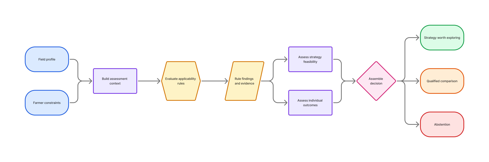

# AgroCycle decision engine

The decision engine is the part of AgroCycle that turns a field profile and a farmer's answers into one of three outcomes: a strategy worth exploring, a qualified comparison, or an abstention. It is a pure Python package with no I/O, no randomness and no model calls. The same inputs always give the same result, and every sentence in the result traces back to a rule or an evidence record written in one file.

This document explains how the engine is built, what it accepts and returns, how its rules work, how it is validated, and how to change it safely. For what AgroCycle is and why, see the [root README](../README.md) and the [PRD](../PRD.md). For the service that runs the engine, see the [API README](../api/README.md).

## Contents

- [1. Purpose and scope](#1-purpose-and-scope)
- [2. Architecture and responsibilities](#2-architecture-and-responsibilities)
- [3. Assessment lifecycle](#3-assessment-lifecycle)
- [4. Input data contract](#4-input-data-contract)
  - [FieldProfile](#fieldprofile)
  - [FarmerConstraints](#farmerconstraints)
  - [Indicator statuses](#indicator-statuses)
  - [Context keys](#context-keys)
- [5. Strategy profiles](#5-strategy-profiles)
- [6. Outcome evidence model](#6-outcome-evidence-model)
- [7. Applicability rules](#7-applicability-rules)
  - [Anatomy of a rule](#anatomy-of-a-rule)
  - [Operators](#operators)
  - [Targets and effects](#targets-and-effects)
  - [The current rules](#the-current-rules)
- [8. Unknown and missing-data semantics](#8-unknown-and-missing-data-semantics)
- [9. Decision outcomes](#9-decision-outcomes)
- [10. Assessment output contract](#10-assessment-output-contract)
- [11. Rule versioning and documentation](#11-rule-versioning-and-documentation)
- [12. Validation and test-set audit](#12-validation-and-test-set-audit)
- [13. Testing](#13-testing)
- [14. Adding or modifying rules](#14-adding-or-modifying-rules)
- [15. Frontend engine synchronisation](#15-frontend-engine-synchronisation)
- [16. Limitations and scientific review status](#16-limitations-and-scientific-review-status)
- [17. Related documentation](#17-related-documentation)

---

## 1. Purpose and scope

**What the engine does.** For one field, it compares three crop-rotation strategies against the evidence from the Marsden Farm experiment (Davis et al. 2012) and decides how much of that evidence can honestly be offered for this field and this farmer. It answers one question: *is the evidence strong enough, for this field and this farm, to say a diversified rotation is worth exploring locally?*

**What it does not do.**

- It does not recommend a rotation, rank the strategies, pick a winner or compute a score. PRD 8.4 requires that a comparison can be returned without a winner, and PRD 8.5 forbids a composite number whose components and weights are not explicit.
- It does not predict yield, profit, soil carbon, erosion or nitrate leaching for the field. The last three are present in the rule table as closed outcomes and are always returned as `not_assessed`.
- It does not calculate profitability. The data PRD 9 requires for it is not available.
- It does not decide what the evidence says. The statements, sources and cautions are written once in the rule table. The engine only selects among them.
- It does not let the farmer's priorities change the decision. `assess` records them and ignores them. A separate, optional step (`engine/emphasis.py`, [section 10](#10-assessment-output-contract)) can reorder a finished decision and call out the gaps that matter for the priorities chosen, but it never changes an outcome, a feasibility or any ranking.

**Role in the product.** The API builds a `FieldProfile` from stored indicators, takes the farmer's four yes/no answers, calls `assess`, and returns the `Decision`. The web app shows it. An AI model may later *explain* a stored decision, but it never produces one.

---

## 2. Architecture and responsibilities

```
engine/
  decision.py              Evaluates the rules. Input and output types, the UNKNOWN sentinel, assess().
  rules/
    strategy_rules.py      The rule table: strategies, outcomes, crop claims, applicability rules.
                           Data and a document renderer only. Decides nothing.
    tests/                 Tests of the table itself
  tests/                   Tests of the evaluator, and the fixed validation matrix
  sweep.py                 Runs the engine over every demonstration field under three scenarios
  load_test_set.py         Loads the sweep's rows into ClickHouse for the validation endpoint
  load_rules.py            Copies the rule table into ClickHouse so the API need not import Python
  emphasis.py              Reorders a finished decision for the farmer's priorities. Cannot change the decision
  season_stress.py         The season stress view over the weather indicators, with its thresholds
  transition.py            The year-by-year sequence for switching to strategy B or C
```

| Module | Responsibility | Must not |
|---|---|---|
| `decision.py` | Normalise nulls, build the context, test each rule's condition, aggregate findings into outcome and strategy statuses, choose one of three decisions. | Contain a threshold, a sentence of evidence or any agronomy. |
| `rules/strategy_rules.py` | Hold every piece of policy and evidence as frozen dataclasses, and render them to the reviewable document. | Import `decision.py`, read data or evaluate a condition. |
| `sweep.py` | Build a profile for each field from the indicator table and field file, assess it under three constraint scenarios, write the audit CSV and manifest. | Change an assessment. It only calls `assess`. |
| `load_test_set.py` | Create the `engine_test_set` table if absent and load the CSV. Dry run unless `--yes`. | Run as part of the API. |
| `load_rules.py` | Copy the rule table into ClickHouse (`engine_rules`, `engine_outcomes`, `engine_crop_claims`, `engine_strategies`, `engine_transition_steps`), tagged with `RULES_VERSION`, and create the season-stress view. Dry run unless `--yes`. | Become a second source of truth. It only copies; the Python module stays authoritative. |
| `emphasis.py` | Take a finished `Decision` and return the same outcomes reordered, with the outcomes and gaps that match the farmer's priorities called out. | Change what the engine concluded, hide an outcome, or score one strategy against another. |
| `season_stress.py`, `transition.py` | Data and definitions only: the season-stress view and its thresholds, and the transition steps. | Invent timings. See [section 10](#10-assessment-output-contract). |

**The rule table is a Python module.** Importing `engine.rules.strategy_rules` is what loads it for the engine, so a malformed rule fails at import or in the table's tests rather than at request time. The same module is read by the engine, the document renderer and the frontend export. `load_rules.py` exists for readers that should not import Python: it writes one row per rule, outcome, crop claim and strategy, each carrying its `rules_version`. List-valued columns are stored as JSON text. Loading replaces the rows for the current version and keeps older versions, so readers must pick the newest version by `loaded_at`, not by `max(rules_version)`, which is a string comparison. The API serves these tables at `GET /evidence/rules`, with a `matches_engine` flag that is false when the loaded version differs from the running engine's.

```bash
uv run python -m engine.load_rules          # dry run: row counts per table
uv run python -m engine.load_rules --yes    # create if needed, then load
```

The split is deliberate. A reviewer who does not read Python can review `docs/rules/strategy-profiles-and-applicability.md`, which is generated from the table. A developer can change evaluation logic without touching policy, and the other way round.

---

## 3. Assessment lifecycle



`assess(profile, constraints)` runs these steps in order.

1. **Normalise.** When a `FieldProfile` or `FarmerConstraints` is built, any `None` in an answer field becomes `UNKNOWN` ([section 8](#8-unknown-and-missing-data-semantics)).
2. **Build the context.** `build_context` flattens the profile and constraints into one dictionary of ten keys, and derives `required_indicators_all_known` from the indicator statuses.
3. **Find the findings.** `fired_rules` tests every applicability rule against the context and returns a `RuleFinding` for each rule whose condition holds, in table order.
4. **Assess each outcome.** For each of the nine outcomes in the table:
   - a non-claimable outcome becomes `not_assessed` and carries no statement, whatever the rules produced;
   - a claimable outcome collects the findings that target it or target `all_outcomes`, takes the **worst** effect, and maps it to a status. The outcome's statement is included only when the status is `in_domain` or `qualified`.
5. **Assess each strategy.** Strategies B and C collect the findings aimed at their own feasibility target. Their feasibility is the worst effect, mapped to `available`, `qualified` or `unavailable`. If any `all_outcomes` finding is `out_of_domain`, every strategy, including A, is `unavailable`.
6. **Collect unknowns.** Every context key that is `UNKNOWN`, sorted, followed by each required indicator that is not `ok`.
7. **Decide.** `_decide` applies the rules in [section 9](#9-decision-outcomes) and returns the decision and a one-sentence reason.
8. **Assemble.** The `Decision` carries the three-way outcome, all three strategy assessments, all nine outcome assessments, the unknowns, what the farmer said, the rules version and the standing limitations. A decision always has the full structure, including when it abstains.

Severity is ordered `in_domain` < `qualified` < `abstain_outcome` < `out_of_domain`, and the worst finding wins.

---

## 4. Input data contract

Both input classes are frozen dataclasses defined in `decision.py`.

### FieldProfile

What the profile endpoints know about a field, reduced to what the rules read.

| Field | Type | Required | Meaning |
|---|---|---|---|
| `field_id` | `str` | yes | Identifier, echoed in the result. |
| `boundary_source` | `str` | yes | Where the polygon came from (for example `demo`), echoed in the result. |
| `crop_history_summary` | `str` | yes | One-line description of the recent crop sequence, echoed in the result. |
| `county` | `str` or `UNKNOWN` | no | County name. Default `UNKNOWN`. |
| `crop_history_is_maize_soybean` | `bool` or `UNKNOWN` | no | Whether the classified crop history is a maize–soybean rotation. `UNKNOWN` when the history could not be classified. |
| `gdd_season_difference_vs_marsden` | `float` or `UNKNOWN` | no | Absolute difference between the field's mean growing-season degree-days (°C) and the Marsden site's. |
| `frost_free_days` | `int` or `UNKNOWN` | no | Length of the frost-free window. |
| `dominant_drainage_class` | `str` or `UNKNOWN` | no | Most common SSURGO drainage class. |
| `indicator_statuses` | mapping `str → str` | no | Status of each required indicator. Default empty. |

`gdd_season_difference_vs_marsden`, `frost_free_days` and `dominant_drainage_class` are carried so the profile is complete, but **no active rule reads any of them** (the rules that did were withdrawn, see [section 16](#16-limitations-and-scientific-review-status)). They still appear in `unknowns` when they are `UNKNOWN`.

### FarmerConstraints

What the farmer has said. Anything unstated stays `UNKNOWN`, never `False`.

| Field | Type | Meaning |
|---|---|---|
| `manure_access` | `bool` or `UNKNOWN` | Can the farmer get manure. |
| `forage_use_or_buyer` | `bool` or `UNKNOWN` | Is there a use or a buyer for alfalfa. |
| `oat_use_or_buyer` | `bool` or `UNKNOWN` | Is there a use or a buyer for oat grain and straw. |
| `small_grain_equipment_or_contractor` | `bool` or `UNKNOWN` | Is small-grain harvest equipment or a contractor available. |
| `priorities` | `tuple[str, ...]` | The farmer's stated priorities. Recorded by `assess`, which does not act on them. See [`emphasis.py`](#10-assessment-output-contract). |

**Building from JSON.** The web app sends `true`, `false` or `null` for each answer. `FarmerConstraints.from_mapping(answers)` converts that mapping: `null` and absent keys both become `UNKNOWN`. Use it for any input that began life as JSON. Constructing the dataclass directly also normalises `None`, so passing a raw `None` cannot leak through either way.

### Indicator statuses

`indicator_statuses` maps indicator ids to a status string. The engine requires four indicators:

| Required indicator | What it stands for |
|---|---|
| `gdd` | Growing-season degree-days |
| `precipitation_total` | Season precipitation |
| `frost_window` | Frost-free window |
| `om_r_0_30cm` | Soil organic matter, 0–30 cm |

An indicator counts as known only when its status is exactly `"ok"`. Any other string, or a missing key, means unknown. If **any** of the four is not `ok`, the rule `applicability_indicator_coverage` fires and every claimable outcome is withheld.

Callers collapse the indicator runner's per-season statuses (`available`, `partial`, `unknown`) into one `ok` or `unknown` per required indicator, and map the runner's `frost_free_days` onto `frost_window`. **Only `available` counts as `ok`.** A `partial` value is real but was computed over less than the whole window or area, so a comparison built on it would not be the comparison the engine describes. The API does this in `api/core/profile.py` and `sweep.py` does the same; the two disagreed until 2026-11-15. The mapping lives in the callers, not in the engine.

### Context keys

These are the keys a rule's `context_key` may name. A test requires that the context supplies every key the table uses.

| Key | Comes from |
|---|---|
| `county` | `FieldProfile.county` |
| `crop_history_is_maize_soybean` | `FieldProfile.crop_history_is_maize_soybean` |
| `gdd_season_difference_vs_marsden` | `FieldProfile.gdd_season_difference_vs_marsden` (no rule reads it) |
| `frost_free_days` | `FieldProfile.frost_free_days` (no rule reads it) |
| `dominant_drainage_class` | `FieldProfile.dominant_drainage_class` (no rule reads it) |
| `manure_access` | `FarmerConstraints.manure_access` |
| `forage_use_or_buyer` | `FarmerConstraints.forage_use_or_buyer` |
| `oat_use_or_buyer` | `FarmerConstraints.oat_use_or_buyer` |
| `small_grain_equipment_or_contractor` | `FarmerConstraints.small_grain_equipment_or_contractor` |
| `required_indicators_all_known` | Derived: `True` only when all four required indicators are `ok`. Always a real boolean, never `UNKNOWN`. |

---

## 5. Strategy profiles

Three strategies, defined as `StrategyProfile` records. Each is anchored to a treatment of the Marsden Farm experiment, Davis et al. (2012), *PLOS ONE* 7(10): e47149.

| ID | Rotation | Phases | Operational requirements |
|---|---|---|---|
| **A** | Two-year maize–soybean (the existing system) | maize, soybean | Equipment and markets already in place. Nitrogen bought as manufactured fertiliser. |
| **B** | Three-year maize–soybean–oat/red clover | maize, soybean, oat + red clover | A use or buyer for oat grain and straw. Red clover establishment, usually frost-seeded into the small grain. Manure access. Equipment and labour for small-grain harvest. |
| **C** | Four-year maize–soybean–oat/alfalfa–alfalfa | maize, soybean, oat + alfalfa, alfalfa | A forage use or buyer for alfalfa across two years. Alfalfa establishment, multiple cuts and forage handling. Manure access. Equipment and labour for small-grain and forage harvest. A quarter of the land out of maize and soybean for two years at a time. |

Strategy A is the baseline every comparison is measured against. It is never a candidate: `Decision.candidate_strategies()` returns only B and C, and only those whose feasibility is not `unavailable`.

Each profile also carries `why_included`, a one-sentence reason it is in the comparison, and an `evidence_anchor` naming the Marsden treatment it rests on.

---

## 6. Outcome evidence model

An `OutcomeEvidence` record is what may be said about one dimension of the comparison. There are nine.

| Field | Meaning |
|---|---|
| `outcome_id` | Stable identifier, used as a rule target. |
| `label` | Plain-language name. |
| `claimable` | Whether the engine may say anything about it. |
| `evidence_type` | One of `observed`, `derived`, `classified`, `survey`, `model_reanalysis`, `experimental`, `published`, `assumption`, or `None` when not claimable. |
| `source` | Where the evidence comes from, or `None`. |
| `statement` | What may be said. Shown only when the outcome's status is `in_domain` or `qualified`. |
| `caution` | A plain sentence shown with the statement. Always present, including for closed outcomes. |
| `caution_reference` | A short source line shown beside the caution. |

| Outcome | Claimable | Evidence type | Source |
|---|---|---|---|
| `applied_n_reduction` | yes | `experimental` | Davis et al. supplement, reproduced in `transform/marsden` |
| `herbicide_reduction` | yes | `experimental` | Davis et al. supplement, reproduced in `transform/marsden` |
| `yield_parity` | yes | `published` | Davis et al. (2012), attributed to the paper, not recomputed |
| `profitability_parity` | yes | `published` | Davis et al. (2012), attributed to the paper, under its own prices and costs |
| `weed_suppression` | yes | `published` | Davis et al. (2012), attributed to the paper, not recomputed |
| `soil_carbon_change` | **no** | none | Nothing AgroCycle uses measures it |
| `erosion_reduction` | **no** | none | Nothing AgroCycle uses measures it |
| `nitrate_leaching_reduction` | **no** | none | Applying less nitrogen is not measuring less leaching |
| `forage_supply` | **no** | none | No forage yield, quality or feed-value source found yet |

The distinction between `experimental` and `published` matters. `experimental` figures are ones AgroCycle reproduced from the Marsden management records (applied nitrogen 74.5, 56.6 and 40.8 kg N/ha/yr and herbicide 1.925, 0.261 and 0.195 kg ai/ha/yr for the two-, three- and four-year systems). `published` results are the researchers' own conclusions, attributed to them, because the field-by-field data needed to recompute them is not in the published record.

The four closed outcomes exist on purpose. A named, closed entry makes the engine return an explicit `not_assessed`. A gap would invite a later contributor to fill it.

The table also holds eight `CropClaim` records, the agronomic claims behind the "why this crop" explanation. Only one is sourced (manure was applied to the diversified Marsden systems). The other seven are `research_needed` and must not be shown as explanations until a citable source exists (PRD 7.5). The engine does not evaluate crop claims; they exist so the gap is visible, and a test enforces that no rule rests on one.

Each claim also says where and under what management it was observed (`geography`, `management_context`) and when it applies (`applies_when`). For a claim with no source these read "not established", which states the gap more strongly than the status alone: if we cannot name where something was observed, we cannot say where it would hold. The Marsden claims name their site (Boone County, one site, nine seasons, 2003–2011) and the composted-manure management it was run under.

---

## 7. Applicability rules

An applicability rule decides whether the Marsden evidence transfers to this field and farm, for one outcome at a time.

### Anatomy of a rule

Each rule is an `ApplicabilityRule` with exactly one condition.

| Field | Meaning |
|---|---|
| `rule_id` | Unique identifier, prefixed `applicability_`. Appears in findings and the audit. |
| `outcome_id` | The **target** the rule affects ([below](#targets-and-effects)). |
| `context_key` | Which context value to test. |
| `operator` | How to test it. |
| `value` | What to compare against. `None` for `is_unknown`. |
| `effect` | What happens when the condition holds. |
| `condition_text` | The condition in a sentence a reader can check. |
| `rationale` | Why the rule exists, in a sentence or two. |
| `evidence_basis` | `experimental_context` (grounded in how the Marsden experiment was run) or `team_proposed` (a judgement the team has not had reviewed). |
| `geography`, `crop`, `management_context` | Where, for which crop and under what management the rule's basis applies. Most rules are guardrails on the farmer's own answer or on data coverage, so they read "not place-specific", "not crop-specific" and "not management-specific". |
| `review` | `not_expert_reviewed` or `expert_reviewed`. Every rule is currently `not_expert_reviewed`. |

A rule carries one condition, so interactions between conditions cannot be expressed. See [section 16](#16-limitations-and-scientific-review-status).

### Operators

| Operator | Condition holds when |
|---|---|
| `equals`, `not_equals` | the value is known and equal, or not equal, to `value`. |
| `in`, `not_in` | the value is known and is, or is not, a member of `value`. |
| `lt`, `lte`, `gt`, `gte` | the value is a known number and compares as stated. A non-number raises `TypeError`, and `True` and `False` are rejected as numbers. |
| `is_unknown` | the value is `UNKNOWN`. The only operator that fires on an unknown. |

An unsupported operator raises `ValueError` rather than being skipped.

### Targets and effects

**Targets.** A rule's `outcome_id` is one of:

- one of the nine outcome ids (affects that outcome only);
- `strategy_b_feasibility` or `strategy_c_feasibility` (affects whether that strategy is operationally available);
- `all_outcomes` (applies to the whole comparison).

This is how PRD 7.6 is met: missing manure access limits the nitrogen comparison without invalidating the herbicide comparison, because the manure rules target `applied_n_reduction` alone.

**Effects.**

| Effect | Meaning | Outcome status | Strategy feasibility |
|---|---|---|---|
| `in_domain` | No concern. The status of an outcome no rule touches. | `in_domain` | `available` |
| `qualified` | Show it, with the reason. | `qualified` | `qualified` |
| `abstain_outcome` | Withhold pending data. | `abstained` | `qualified` |
| `out_of_domain` | Do not offer it. | `out_of_domain` | `unavailable` |

### The current rules

Fourteen rules, rules version `2026-11-15.5`. The full text with rationales is in the [generated reference](../docs/rules/strategy-profiles-and-applicability.md).

| Rule | Target | Fires when | Effect |
|---|---|---|---|
| `applicability_manure_access_applied_n` | `applied_n_reduction` | manure access is `False` | `out_of_domain` |
| `applicability_manure_unknown_applied_n` | `applied_n_reduction` | manure access is unknown | `abstain_outcome` |
| `applicability_crop_history_baseline` | `all_outcomes` | crop history is not maize–soybean | `out_of_domain` |
| `applicability_crop_history_unknown` | `all_outcomes` | crop history is unknown | `abstain_outcome` |
| `applicability_outside_demo_counties` | `all_outcomes` | county not in Story, Boone | `qualified` |
| `applicability_indicator_coverage` | `all_outcomes` | a required indicator is not `ok` | `abstain_outcome` |
| `applicability_forage_outlet_strategy_c` | `strategy_c_feasibility` | no forage use or buyer | `out_of_domain` |
| `applicability_forage_outlet_unknown` | `strategy_c_feasibility` | forage outlet unknown | `qualified` |
| `applicability_oat_outlet_strategy_b` | `strategy_b_feasibility` | no oat use or buyer | `qualified` |
| `applicability_oat_outlet_unknown` | `strategy_b_feasibility` | oat outlet unknown | `qualified` |
| `applicability_machinery_small_grain` | `strategy_b_feasibility` | no small-grain equipment or contractor | `qualified` |
| `applicability_machinery_unknown` | `strategy_b_feasibility` | machinery access unknown | `qualified` |
| `applicability_machinery_small_grain_strategy_c` | `strategy_c_feasibility` | no small-grain equipment or contractor | `qualified` |
| `applicability_machinery_unknown_strategy_c` | `strategy_c_feasibility` | machinery access unknown | `qualified` |

The Strategy C machinery rules were added on 2026-11-15 after the validation matrix showed that the machinery rules qualified the three-year option and left the four-year one untouched, although the four-year rotation has an oat phase too. The climate-distance rules were withdrawn the same day ([section 16](#16-limitations-and-scientific-review-status)).
---

## 8. Unknown and missing-data semantics

**Unknown is not false.** `UNKNOWN` is a singleton sentinel, distinct from `False` and from `None`. It has no truth value: using it in an `if` raises `TypeError`, so the mistake of treating it as `False` cannot be made silently. Code tests it with `is UNKNOWN`.

The consequence is a pair of rules for every important input:

- a condition such as `manure_access equals False` fires **only when the farmer said no**;
- when the farmer said nothing, the paired `is_unknown` rule fires instead, and the outcome is withheld or qualified.

So "I did not ask" and "the answer was no" lead to different, correctly worded results. Missing data is never read as favourable, and never as evidence of no risk (PRD 8.5).

**JSON `null` normalisation.** The web app sends `null` for "not answered" and for "Not sure". Left as `None`, that would be a known value to every operator except `is_unknown`, no unknown rule would fire, and an unanswered question would look available. So `None` is converted to `UNKNOWN` when the dataclass is built (`__post_init__`), and `FarmerConstraints.from_mapping` converts absent keys too. The conversion is at the boundary so that it cannot be forgotten in a caller.

**Unknown indicators.** An indicator counts as known only when its status is exactly `ok`. A missing key counts as unknown.

**Reporting.** `Decision.unknowns` lists every context key that was `UNKNOWN` plus each indicator that was not `ok`, so a reader can see what the engine did not know. An empty profile abstains and lists everything it is missing.

---

## 9. Decision outcomes

`Decision.outcome` is exactly one of three values, from PRD 8.3. They are evaluated in this order, and the first that applies wins.

| # | Outcome | Triggered when |
|---|---|---|
| 1 | `abstention` | Any `all_outcomes` finding has effect `out_of_domain`. The reason names the rule ids. |
| 2 | `abstention` | No claimable outcome has status `in_domain` or `qualified`, so there is nothing to compare. |
| 3 | `strategy_worth_exploring` | At least one of B and C has feasibility `available`, **and** every claimable outcome is `in_domain`. |
| 4 | `qualified_comparison` | Everything else: the strategies can be compared but not separated. |

Reading the table:

- **`strategy_worth_exploring`** is the strongest thing the engine says, and it is worded as "a candidate for local evaluation, not a recommendation". It requires a clean result on all five claimable outcomes. The four closed outcomes do not count against it.
- **`qualified_comparison`** is reached when any outcome is qualified, abstained or out of domain but at least one outcome is still speakable, or when no strategy is operationally available despite clean evidence. The reason says how many claimable outcomes were withheld.
- **`abstention`** means the evidence is missing, inadequate or outside the supported domain. A field that is not in a maize–soybean rotation abstains. So does a field whose required indicators came back unknown, because that withholds all five claimable outcomes.

No outcome produces a winner. All three strategies are always returned, including one that is `unavailable`.

---

## 10. Assessment output contract

`assess` returns a frozen `Decision`. The API serialises it with `api/core/serialise.py`, and the web app's `Decision` type mirrors it.

### Decision

| Field | Type | Meaning |
|---|---|---|
| `field_id`, `boundary_source`, `crop_history_summary` | `str` | Echoed from the profile. |
| `outcome` | `str` | One of the three decision outcomes. |
| `outcome_reason` | `str` | One sentence saying why. |
| `strategies` | `tuple[StrategyAssessment, ...]` | A, B and C, always all three. |
| `outcomes` | `tuple[OutcomeAssessment, ...]` | All nine outcomes, always. |
| `unknowns` | `tuple[str, ...]` | Context keys and indicators that were unknown. |
| `constraints_recorded` | mapping | What the farmer said for the four yes/no answers. Unstated ones are `UNKNOWN`. |
| `priorities_recorded` | `tuple[str, ...]` | The farmer's priorities, unchanged. |
| `rules_version` | `str` | The `RULES_VERSION` that produced this result. |
| `limitations` | `tuple[str, ...]` | The standing limitations, always the same five (see [section 16](#16-limitations-and-scientific-review-status)). |

`Decision.candidate_strategies()` returns the ids of B and C that are not `unavailable`.

### StrategyAssessment

| Field | Meaning |
|---|---|
| `strategy_id`, `label`, `rotation` | From the strategy profile. |
| `feasibility` | `available`, `qualified` or `unavailable`. |
| `operational_requirements` | What the farmer needs to run it. |
| `findings` | The `RuleFinding`s that set the feasibility. Always empty for A. |

### OutcomeAssessment

| Field | Meaning |
|---|---|
| `outcome_id`, `label` | From the outcome record. |
| `status` | `in_domain`, `qualified`, `abstained`, `out_of_domain` or `not_assessed`. |
| `claimable` | Whether the outcome may be claimed at all. |
| `evidence_type`, `source` | From the outcome record. `None` when not claimable. |
| `statement` | What may be said. `None` unless status is `in_domain` or `qualified`. |
| `caution`, `caution_reference` | Always present. |
| `findings` | The `RuleFinding`s that set the status. |

### RuleFinding

| Field | Meaning |
|---|---|
| `rule_id` | The rule that fired. |
| `target` | The outcome or feasibility target it applied to. |
| `effect` | The rule's effect. |
| `condition_text`, `rationale` | Copied from the rule. |
| `review` | The rule's review status. |

Every claim in the result can be followed: a status comes from findings, a finding names a rule id, and the rule id is in the generated reference.

### Emphasis, season stress and transition

Three modules sit beside `assess`. None of them changes a decision.

- **`emphasis.py`: priorities.** `emphasise(decision, priorities)` takes a finished `Decision` and the farmer's priorities (`soil`, `water`, `inputs`, `income`, `forage`, each `high`, `medium` or `low`) and returns an `EmphasisedComparison`: the same outcomes, reordered so the ones that speak to a chosen priority come first, plus `highlighted` outcome ids and `gaps_for_priorities`, the plain-language things the evidence cannot say for each chosen priority (for example, that nothing measures soil carbon or erosion on the field). The outcome, its reason, every strategy's feasibility and every outcome's status are untouched. Every outcome is still returned, including the closed ones, because hiding an outcome the farmer did not ask about is how a comparison becomes a sales pitch. A priority rated `low` is an answer and promotes nothing, the same as silence. This is the PRD 8.5 reading: priorities decide what is shown first and what is called out, never the result. **It is built and tested but not yet called by the API or the web app.**
- **`season_stress.py`: past weather.** A ClickHouse view over `field_indicators` (so it cannot drift from the indicators) with one row per field and season, plus a thresholds table stating the temperature or day count behind each column. Every threshold is team-proposed and not expert-reviewed. It counts weather over a whole season and makes no claim about a crop stage, because neither the Marsden supplement nor the paper gives a planting date, phase window or crop-stage threshold. The view and its thresholds are loaded by `load_rules.py`. `GET /fields/{id}/season-summary` is built separately in the API from the same `field_indicators` rows (`api/core/season_summary.py`), not by reading the view, so the two agree because they share their source, not because one calls the other.
- **`transition.py`: switching to B or C.** The year-by-year sequence for each option. The sequence and the October manure application come from the experiment (`experimental`); operational needs derived from the rotation definition are `team_proposed`; and every timing the experiment does not give reads "not established" rather than a plausible sowing date. No row is an `assumption`, and a test keeps it that way.

---

## 11. Rule versioning and documentation

**`RULES_VERSION`** is a string in `strategy_rules.py` of the form `YYYY-MM-DD.N` (currently `2026-11-15.5`). It is copied into every `Decision`, every stored analysis and every row of the test-set audit, so any result can be matched to the rules that produced it.

**Bump it whenever the table changes in a way that can alter a result**: a rule added, removed or changed, an effect changed, an outcome's claimability changed, or a statement or caution changed. Use today's date, and increment `N` for a second change on the same day. A change that cannot alter a result, such as fixing a typo in a comment, does not need a bump.

**The generated reference.** `docs/rules/strategy-profiles-and-applicability.md` is rendered from the table by `render_markdown()`. It lists the strategies, outcomes, crop claims, rules and known weaknesses, and it leads with the review status. Never edit it by hand. Regenerate it from the repository root:

```bash
uv run python -m engine.rules.strategy_rules
```

A test (`test_the_committed_document_matches_the_table`) fails if the committed file differs from what the table would render, so the two cannot drift.

---

## 12. Validation and test-set audit

The sweep answers one question: across the whole test set, what does the engine actually do, and which rules never fire?

**The field sweep.** `engine/sweep.py` reads `data/out/indicators/field_indicators.csv` (the indicator runner's output) and `data/fields/fields.geojson`. For each of the 45 demonstration fields it builds a `FieldProfile`, taking the latest value of each indicator, and assesses it under three constraint scenarios:

| Scenario id | Constraints |
|---|---|
| `every_constraint_stated` | all four answers `True` |
| `no_manure` | manure access `False`, the rest `True` |
| `nothing_stated` | all four `UNKNOWN` |

The scenarios matter more than any single row. With every constraint stated the engine can look as though it always says yes. Withholding one fact the farmer might not volunteer shows the result moving with the evidence.

```bash
uv run python -m engine.sweep
```

**Outputs.** Written to `data/out/validation/` (not committed):

- `engine_test_set.csv`: one row per field per scenario (135 rows for 45 fields). Columns: `field_id`, `scenario`, `crop_history_summary`, `outcome`, `outcome_reason`, `strategy_a_feasibility`, `strategy_b_feasibility`, `strategy_c_feasibility`, `outcomes_in_domain`, `outcomes_qualified`, `outcomes_abstained`, `outcomes_out_of_domain`, `outcomes_not_assessed`, `rules_fired` (JSON list), `unknowns` (JSON list), `rules_version`, `run_id`.
- `run_manifest.json`: the `run_id` (`ds2-validation-` plus 12 hex characters), UTC timestamp, rules version, field count, scenario ids, row count and `rules_never_fired`.

The sweep also prints the outcome spread per scenario, the rules that fired and the rules that never fired. **A rule that never fires is either a guardrail for input the test set does not contain, or a threshold that is wrong.** Say which, out loud, before relying on it.

**ClickHouse table.** `engine/load_test_set.py` creates `engine_test_set` if it is absent and loads the CSV:

```bash
uv run python -m engine.load_test_set          # dry run: reports what it would do
uv run python -m engine.load_test_set --yes    # create if needed, then load
```

Loading the same `run_id` again replaces that run's rows instead of duplicating them. Earlier runs stay in place, so the table keeps its history. A run id is random hex, so it does not sort by time: readers must choose the newest run by `loaded_at`, never `max(run_id)`. The table is ordered by `(field_id, scenario, run_id)` and each row carries a `loaded_at` timestamp.

**Validation endpoint.** `GET /validation/test-set` reads the run with the latest `loaded_at` and returns, per field, the engine's outcome under every scenario against an **expected outcome**. The expected outcome is derived from the team's field-selection label: rotation fields should reach a comparison and every other class should abstain. It also returns outcome counts and a CDL agreement summary. It answers 503 if no audit has been loaded. See the [API README](../api/README.md#validation-audit).

**The validation matrix.** `engine/tests/test_validation_matrix.py` is a fixed set of ten scenarios (complete evidence, missing climate, partial soil, uncertain crop history, each operational constraint, out-of-domain history, conflicting evidence, differing priorities). Each states its expected outcome and why, and the test asserts the engine agrees. **The expected column has not been approved.** The author of the rules must not also sign off what they should produce, so `REVIEWED_BY` stays empty until DS1 and BE have reviewed it, and a test reminds anyone who forgets.

**What this shows and does not show.** It shows that the engine is deterministic, consistent and follows its documented rules. It does not show the engine is *right*: the expected outcome is not independent ground truth, the 45 fields are team-drawn demonstration polygons in two counties, and the counts are indicative, not statistically strong. The recorded results are in the [validation summary](../docs/validation/ds2-validation-summary-2026-11-15.md).

---

## 13. Testing

Run from the repository root. The engine tests need no data, no network and no ClickHouse.

```bash
uv run pytest engine -q          # 137 tests, well under a second
make check                       # lint, field-file validation, schema check and every test in the repo
```

| Layer | Where | What it pins |
|---|---|---|
| **Evaluator** | `engine/tests/test_decision.py` | The four categories the roadmap requires (in domain, out of domain, missing data, abstention). That unknown is not false and not true either. That closed outcomes stay `not_assessed` however good the field is. That the result has no score and no winner. That priorities are recorded but change nothing. That the engine is deterministic, handles JSON null, rejects non-numeric values in numeric rules, and returns the full structure when it abstains. |
| **Rule table** | `engine/rules/tests/test_strategy_rules.py` | Structure and consistency of the table: unique ids, valid operators, effects and targets, every claimable outcome has an evidence type and source, no rule targets a closed outcome, no rule rests on an unsourced claim, withdrawn rules stay withdrawn, no rule claims expert review, and the generated document matches the table. Also that farmer-facing text contains no internal shorthand. |
| **Emphasis** | `engine/tests/test_emphasis.py` | That priorities never change the outcome, every outcome is still returned, nothing is ranked or scored, a low priority promotes nothing, and each chosen priority brings its own gap. |
| **Season stress and transition** | `engine/tests/test_stress_and_transition.py` | Every column comes from a real indicator and has a threshold, every threshold is declared team-proposed, nothing claims to be about a crop stage, every transition step declares a known evidence basis, and nothing is an assumption. |
| **Validation matrix** | `engine/tests/test_validation_matrix.py` | Ten fixed scenarios with an expected outcome each. The expected outcomes are not yet signed off ([section 12](#12-validation-and-test-set-audit)). |
| **Integration** | `api/tests/`, `tests/` | The API builds profiles and calls the engine; ClickHouse checks skip when settings are missing. |
| **Web export is current** | `api/tests/test_web_export_is_current.py` | Re-runs the frontend export in memory and fails if the committed JSON differs from the engine in any way, including a reworded sentence under the same `RULES_VERSION`. |
| **Frontend parity** | `web/src/features/compare/engine-parity.test.ts` | The TypeScript fallback reproduces the committed parity fixture for 567 profile and constraint combinations. See [section 15](#15-frontend-engine-synchronisation). |

```bash
cd web && npm run test           # includes the parity test
```

Nothing in the engine tests needs the S3 raw data, so they run for anyone with the repository.

---

## 14. Adding or modifying rules

Follow this order. Skipping a step is how a rule ends up unreviewable.

1. **Write down the claim first.** What is the rule saying about the world, and where does that come from? If the answer is "it seems reasonable", the rule is `team_proposed`, and it must say so. If the claim is agronomic and there is no citable source, add it to `CROP_CLAIMS` as `research_needed` and **do not write a rule that depends on it**. A test fails if one does. Two rules were withdrawn for exactly this reason.
2. **Choose one target.** Decide which single outcome, feasibility or `all_outcomes` the rule affects. If it should affect two outcomes, write two rules. Never write one that implies a whole strategy is bad.
3. **Pair it with an unknown rule.** For any condition on a farmer answer or a profile value, also write the `is_unknown` rule, and choose its effect deliberately. Missing data must never pass as favourable.
4. **Edit `strategy_rules.py`.** Add the `ApplicabilityRule`. Write `condition_text` so a non-programmer can check it, and `rationale` so a reviewer can disagree with it. Leave `review` at its default. Only a recorded expert review changes it.
5. **If the rule reads a new context key**, add it to `build_context` in `decision.py` and to the profile or constraints dataclass, and make the API supply it (`api/core/profile.py`).
6. **If you add or change evidence** (an `OutcomeEvidence` record), state the evidence type honestly: `experimental` only for something AgroCycle reproduced, `published` for a result attributed to a paper. Give the source line, a statement that claims no more than the source, and a caution that says what it does not show.
7. **Bump `RULES_VERSION`.**
8. **Regenerate the reference:**
   ```bash
   uv run python -m engine.rules.strategy_rules
   ```
9. **Add tests.** In `engine/tests/test_decision.py`, add one case where the rule fires and one where its condition holds but the value is unknown. In `engine/rules/tests/test_strategy_rules.py`, extend the structural tests if the rule introduces a new kind of thing. Then run `uv run pytest engine -q`.
10. **Re-run the sweep** if you can (it needs the indicator table) and read the "never fired" list. A new rule that never fires on the test set needs an explanation.
11. **Sync the frontend** ([section 15](#15-frontend-engine-synchronisation)) and run `cd web && npm run test`.
12. **Say it is unreviewed.** In the pull request, state that the change is not expert-reviewed unless it is.

Do not add a new operator, outcome status or decision outcome without changing `decision.py`, the TypeScript port, the API schemas and the tests together.

---

## 15. Frontend engine synchronisation

**The API is the authoritative engine.** The web app can run without it, but only as a labelled offline fallback: `web/src/features/compare/evaluate.ts` is a TypeScript port of `assess` that holds no policy of its own. It sees a thinner profile than the API (no weather, no drainage), so it does not give the API's answer for the same field, and production builds refuse to use it unless `AGROCYCLE_ALLOW_OFFLINE_ENGINE=true`. Every rule, label and sentence comes from a JSON export of the Python rule table.

```bash
cd web && npm run sync:engine
```

This runs `web/scripts/export_engine.py`, which imports the real engine and writes two files into `web/src/features/compare/data/`:

| File | Contents |
|---|---|
| `rules.generated.json` | Strategies, outcomes, applicability rules, crop claims, standing limitations, the required-indicator list and the rules version, exactly as the table holds them. The unknown sentinel becomes `null`. |
| `engine-parity.generated.json` | What the real engine returns for 7 profiles × 81 constraint combinations (each of four answers set to true, false or null), in compact form. |

`engine-parity.test.ts` requires the TypeScript port to reproduce every parity case: the outcome, reason, unknowns, strategy feasibilities, outcome statuses and the rule ids behind them.

**Run `npm run sync:engine` whenever you change anything under `engine/rules/` or `engine/decision.py`, and commit the regenerated files with the change.** The script needs Python 3.9 or later and only the standard library.

**Two tests, two jobs.** `engine-parity.test.ts` compares the port to the *committed* parity file, so on its own it cannot notice a forgotten sync: the file is stale, the test still passes. `api/tests/test_web_export_is_current.py` closes that gap. It re-runs the export in memory and fails if either committed file differs from what the engine would write now. If it fails, run `npm run sync:engine` and commit the result. After a sync, `git diff` on the two files should show the change you made and nothing else.

When the web app is given `AGROCYCLE_API_URL`, the API's engine is used and this port is the fallback. See the [web README](../web/README.md).

---

## 16. Limitations and scientific review status

**No rule is expert-reviewed, and the validation matrix's expected outcomes are not signed off.** Every rule is a conservative, team-proposed guardrail, not a universal agronomic threshold (PRD 7.6). The roadmap asks for review by an Iowa-knowledgeable adviser, which has not happened. The generated reference says so on its first lines, and a test fails if any rule claims otherwise.

**The engine's own standing limitations** are returned in every `Decision` so that no result can be read without them:

1. Marsden Farm is one research site over nine seasons. Nothing here predicts what will happen on this field.
2. Climate indicators are POWER grid values, about 50 km across, not field measurements.
3. Soil values come from a mapped survey, not from sampling this field.
4. Every applicability rule is a team-proposed guardrail and is not expert-reviewed.
5. No profitability is calculated; the data PRD 9 requires for it is not available.

**Known weaknesses of the rule table.**

- **Climate transferability is not assessed.** The rule that compared a field's growing-season heat with the Marsden site's was withdrawn on 2026-11-15. Its 300 degree-day band had no published basis, and the largest difference across the 45 test fields is 43, so it could never fire. A guardrail that cannot trigger gives false assurance that the question was asked. Transferability is still assessed on crop history, county and manure access, and the climate difference is still computed as an indicator.
- Seven of the eight crop claims are `research_needed`, so the "why this crop" explanation is thin by design rather than complete.
- A rule carries one condition. Interactions, such as "poor drainage and a short season together", cannot be expressed.
- Two further rules were withdrawn on 2026-11-15 because they rested on unsourced claims: alfalfa on poorly drained soil, which fired on every in-domain field and so separated nothing, and an oat season-length threshold that could never fire. The drainage data is still shown to the farmer; what was removed is the engine's inference from it.
- Disease and pest effects of rotation length are not assessed.
- Priorities do not change the decision, by design (PRD 8.5 forbids a composite score without explicit weights). `emphasise()` can reorder the outcomes and name the gaps for the priorities chosen, but it is not yet called by the API or the web app, which show priorities in their own panel.

**What the engine cannot claim.** That a rotation will improve this field. That one strategy is better than another. Any soil-carbon, erosion or nitrate-leaching benefit. Any financial result. Any forage yield or feed value. Anything about a field outside the maize–soybean domain, which abstains. The engine's strongest statement is that a strategy is a candidate for local evaluation, and the result says in words that it is not a recommendation.

---

## 17. Related documentation

| Document | What it covers |
|---|---|
| [`PRD.md`](../PRD.md) | Requirements. Section 7 (evidence and transferability) and section 8 (decision logic and permitted outcomes) govern the engine. |
| [`docs/rules/strategy-profiles-and-applicability.md`](../docs/rules/strategy-profiles-and-applicability.md) | The generated rule catalogue: strategies, outcomes, crop claims, rules and weaknesses. |
| [`docs/method/ds2-scientific-method.md`](../docs/method/ds2-scientific-method.md) | The scientific method behind the indicators and the comparison. |
| [`docs/validation/ds2-validation-summary-2026-11-15.md`](../docs/validation/ds2-validation-summary-2026-11-15.md) | What was tested over the 45 fields, with results and what they do not establish. |
| [`docs/validation/ds2-claim-check-2026-11-15.md`](../docs/validation/ds2-claim-check-2026-11-15.md) | A check of claims the product makes against their sources. |
| [`docs/diagrams/`](../docs/diagrams/README.md) | Architecture and data-lineage diagrams. |
| [`api/README.md`](../api/README.md) | The service that runs the engine, including `/compare` and the validation audit. |
| [`web/README.md`](../web/README.md) | The interface and its use of the TypeScript fallback. |
| [`specs/roadmap.md`](../specs/roadmap.md) | Phases 9, 10 and 14 and their status. |
| [`specs/features/2026-11-14-ds2-decision-engine/`](../specs/features/2026-11-14-ds2-decision-engine/) | The decision-engine feature spec, plan and validation. |
